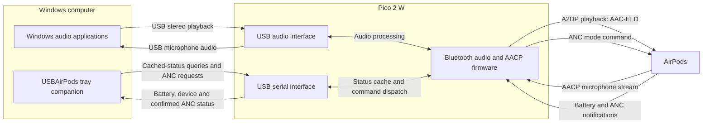

# USB AirPods

USB audio playback, microphone support, and a Windows tray companion for AirPods through a Raspberry Pi Pico 2 W.

## Current release: v1.1.0

This repository contains the **case-battery-anc-v1** firmware and Windows companion, verified together on physical hardware.

- 48 kHz stereo playback with simultaneous microphone use.
- Left, right, and case battery status and ANC control from the Windows tray.
- A dashboard that opens above the taskbar at the lower-right when you click the tray icon.
- Closed-case disconnection, lid-open reconnection preparation, and automatic recovery after range loss.

## Windows companion


*Dashboard preview with sample battery values.* Click the tray icon to open this window at the lower-right above the taskbar. Each card shows the latest available battery reading and charging state. Select an enabled ANC mode to request a change; the current selection follows the mode confirmed by the headphones.

## Connection diagrams

### Physical connection


Plug the Pico into the computer over USB and pair the AirPods with the Pico. The Pico handles Bluetooth; Windows sees a USB audio device and a serial port. The Windows companion runs on the computer and uses that same USB cable.

### Audio and application data



The companion reads cached battery information and sends ANC requests through the Pico. Audio applications use the separate USB audio interface, so the companion does not carry the playback or microphone stream. Closing the companion stops monitoring; it does not disconnect the AirPods Bluetooth link.

## Download and run

[Download the latest release](https://github.com/ermanon/USB-AirPods/releases/latest)

The files are also available in [downloads](downloads):

1. Hold **BOOTSEL** while connecting the Pico 2 W to USB.
2. Copy **PicoW_USB_BT_Audio.uf2** to the bootloader drive. The Pico restarts automatically.
3. Connect your AirPods. When disconnected, a short BOOTSEL press attempts to reconnect to the selected device; a long press followed by release starts discovery. Discovery may select the first compatible audio device, so keep other audio devices out of pairing mode during setup.
4. Run **USBAirPods.exe**. Requires Windows 10/11 and .NET Framework 4.x; no installation or administrator privileges are needed.
5. Select the Pico USB audio device as the Windows output/input. Click the tray icon to open the dashboard.

The computer's Bluetooth adapter is not used. The AirPods' own firmware is not modified.

## Battery and ANC

Battery queries read notifications cached by the Pico rather than sending additional requests to the headphones. The case does not always report its battery; missing or stale information is shown as **unknown**.

Only ANC modes reported by the headphones during the current connection are enabled. To enable a mode for the first time, select it using the headphones' own controls. Queuing a command does not count as success: the app waits for a mode notification from the headphones. Mode verification resets on reconnection.

The **USB connection** menu selects serial monitoring; it does not disconnect the AirPods Bluetooth link. Close other logging applications that have the COM port open.

## Validation and limitations

On AirPods 4 ANC, the user confirmed battery/ANC display, switching ANC off from the app, and clean playback on both earbuds with microphone operation. Firmware compilation, battery/ANC parser tests, **2,515 ARM checks**, and **23 Windows protocol checks** passed. See [VALIDATION.md](VALIDATION.md).

This project is experimental. Earlier tests showed one earbud remaining silent after an initial connection and recovery taking approximately 15 seconds; no permanent fix is claimed. Long-duration use and repeated range/case cycles were not retested for the battery/ANC integration. Raw microphone protocol timing remains under investigation; the decoder reports 48 kHz. An active stream flag does not prove audible playback.

## Build from source

Firmware requires Pico SDK **2.1.1**, Arm GNU **14.2.Rel1**, CMake, and Ninja. Set the PICO_SDK_PATH environment variable to your SDK directory.

```powershell
cmake -S . -B build -G Ninja -DPICO_BOARD=pico2_w -DCMAKE_BUILD_TYPE=Release "-DCMAKE_C_FLAGS_RELEASE=-O3 -DNDEBUG -g"
cmake --build build --parallel 4
```

Windows companion:

```powershell
powershell -ExecutionPolicy Bypass -File windows-tray/build.ps1
powershell -ExecutionPolicy Bypass -File windows-tray/test.ps1
```

Firmware tests and dependencies are described in [tests/README.md](tests/README.md). Download checksums are in [downloads/SHA256SUMS.txt](downloads/SHA256SUMS.txt).

## Credits and licenses

Built on [USBPods-Pico2W](https://github.com/wasdwasd0105/USBPods-Pico2W) and the [two-way audio implementation](https://github.com/han-um/USBPods-Pico2W-2-way-audio-implement). Thanks to the [LibrePods](https://github.com/librepods-org/librepods) community for its AACP protocol work. FDK-AAC and LDAC licenses are retained in their respective directories; project licenses are preserved in [LICENSE](LICENSE) and [LICENSE.Apache-2.0](LICENSE.Apache-2.0).
