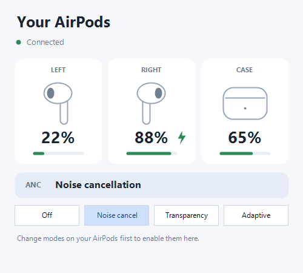
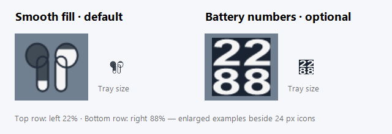

# Windows companion — v1.1.0

Matching firmware: case-battery-anc-v1. Download [USBAirPods.exe](../downloads/USBAirPods.exe) or use the [release page](https://github.com/ermanon/USB-AirPods/releases/latest). The dashboard opens at the lower-right of the clicked monitor above the taskbar. Battery display, ANC Off control and clean stereo/microphone were user-confirmed on AirPods 4 ANC. USB connection menu options control monitoring, not the AirPods Bluetooth link.

# USBAirPods Windows Companion

A Windows 10/11 tray application for AirPods battery monitoring and noise control through a Raspberry Pi Pico 2 W. The interface is in English.

The app shows **one tray icon**, with a choice of smooth-fill earbuds or live battery numbers. Hover over it to see the left, right, and case battery percentages; `+` indicates charging. Left-click for battery details, or right-click for ANC settings and USB connection options.

If you use multiple AirPods sets, connect one and choose **Rename connected AirPods…** in the tray menu. The name is saved for that set's Bluetooth address in your Windows user profile. The dashboard and tooltip then use the saved name and show the address while it is connected.

Each earbud is colored independently: white at 20% or above, yellow at 10–19%, and red at 0–9%. Unknown or stale readings are not shown as low battery. When the headphones disconnect or USB replies stop, the earbud style shows a red X and the text style shows red dashes.

## Dashboard



*Rendered from the app with sample readings.* Left-click the tray icon to open the dashboard. It shows illustrated left, right, and case cards, battery percentages and bars, a charging symbol, and the confirmed ANC mode. Connection and ANC errors appear below the controls.

Use **Off**, **Noise cancel**, **Transparency**, or **Adaptive** to request a mode. **Change modes on your AirPods first to enable them here.** Unverified modes stay disabled. The current mode is highlighted; buttons are also disabled while a request is pending. There is no hover popup on these buttons.

## Tray icon styles



Right-click the tray icon and open **Tray icon**. Choose **Earbuds · smooth fill (default)** for battery levels that fill each earbud smoothly from bottom to top, or **Battery percentages · two rows** for values such as `22` and `88`. The first row is the left earbud and the second is the right. Unknown or stale readings show `--`. The selection lasts for the current app session.

## Installation

1. Hold **BOOTSEL** while connecting the Pico 2 W to USB.
2. Copy `PicoW_USB_BT_Audio.uf2` from the matching release to the RP2350 drive. The Pico restarts automatically.
3. Run `USBAirPods.exe`. No installation or administrator privileges are required. The app uses Windows 10/11's .NET Framework 4.x.
4. Pair and connect your AirPods using the firmware's normal pairing procedure. The tray app automatically finds the USB serial port. If necessary, right-click and select the Pico's COM port under **USB connection**.
5. If Windows hides the tray icon, drag it from the overflow menu to the taskbar notification area.

The computer does not need Bluetooth. Select **USB AirPods** as the audio device. This update does not erase pairing data or add a pairing command. Flashing temporarily interrupts audio.

To start the app at sign-in, press `Win+R`, enter `shell:startup`, and place a shortcut to the EXE in that folder. The app does not add itself to startup automatically.

## Updating the app

Right-click the running tray icon → **Exit**, then replace the EXE and launch the new version. This closes the companion app, not the Pico audio connection.

## Missing or stale readings

- Older firmware does not support battery queries. Flash the matching UF2 first.
- Close PuTTY or any other application using the Pico's serial port. Two applications cannot open the same COM port simultaneously.
- The case may not report its battery continuously. Open the lid and wait briefly. Missing readings appear as `--` or **Unknown**.
- Cached readings are cleared when the headphones disconnect. If USB replies stop for eight seconds, percentages disappear and the app retries the connection.
- Each component's reading is tracked separately. Readings older than five minutes disappear from the tray tooltip and remain available as last-known values in the dashboard hover details. The app does not send extra Bluetooth commands to refresh battery data.
- If multiple USBPods devices are connected, select the correct COM port from the menu. The selection lasts for the current app session.

## ANC status and mode selection

Use the dashboard buttons or right-click and open **ANC**. The current mode is highlighted in the dashboard and checked in the menu. Modes are **Off**, **Noise cancellation**, **Transparency**, and **Adaptive**. These controls require the current ANC-capable firmware.

Only modes actually reported by the headphones during the current connection are enabled. To verify a mode for the first time, select it using the headphones or a connected phone; the Windows menu should update within about two seconds. Verification resets on reconnection. A disabled option may be unverified rather than unsupported. All controls remain disabled if the headphones never send compatible ANC notifications.

Requests use the existing AACP control channel. The check mark reflects the mode reported by the headphones; queuing a request does not count as success. Rejected or busy requests, and changes not confirmed within eight seconds, are explained in the details window. Requests are not retried automatically. Changes made from a phone or the headphones also appear in the menu.

## Headphone communication

The existing handshake, microphone START/STOP commands, A2DP audio path, and reconnection logic are retained. Battery and ANC notifications are read from the existing channel. An extra Bluetooth control packet is sent only when the user selects an ANC mode. The Windows app does not use the computer's Bluetooth adapter.

### Battery USB protocol

Every two seconds, Windows sends `USBPODS BATTERY 1234ABCD` over the existing CDC serial port. The Pico replies from its cache without requesting a new reading from the headphones:

```text
[USBPODS-BATTERY/1] 1234ABCD 1 99 1 10 100 2 10 17 2 10
```

Fields are the query ID, AACP connection state, then `percentage status age_ms` for **left / right / case**, in that order. Unknown percentage is `-1`; age before any reading is `4294967295`. Status values are `0` unknown, `1` charging, `2` discharging, and `4` disconnected. The query ID prevents buffered replies from being mistaken for current data. Serial logs continue on the same port and are ignored by the app.

See [librepods AAP Definitions](https://github.com/librepods-org/librepods/blob/main/docs/AAP%20Definitions.md#battery) for the battery packet format. Component IDs are `0x04` left, `0x02` right, and `0x08` case. The headphones must provide these notifications; the app cannot obtain unsupported readings without additional commands.

### ANC USB protocol

Battery queries also return:

```text
[USBPODS-ANC/1] nonce connected mode verified_mode_mask session
```

Battery queries also include `[USBPODS-DEVICE/1] nonce connected bluetooth_address`. The companion uses this existing pairing address only to select the locally saved device name; it does not send an extra Bluetooth request.

`USBPODS ANC nonce session mode` requests a mode verified in the same connection session. The reply is `[USBPODS-ANC-RESULT/1] nonce result`, where `0` means queued, `1` unavailable, and `2` queue busy. The actual mode changes only after a headphone notification. The USB interrupt handler records the request; Bluetooth processing runs in the main loop under the existing lock.

## Build and test

Run these commands in PowerShell from the repository root:

```powershell
powershell -NoProfile -ExecutionPolicy Bypass -File .\windows-tray\build.ps1
powershell -NoProfile -ExecutionPolicy Bypass -File .\windows-tray\test.ps1
powershell -NoProfile -ExecutionPolicy Bypass -File .\tests\test-firmware-parser.ps1
```

The app is written to `windows-tray/dist/USBAirPods.exe`. Build the firmware using the CMake instructions in the [main README](../README.md).

`tests/battery_test.c` checks battery packets and USB queries using a standard C11 compiler. The supplied `tests/test-firmware-parser.ps1` script requires Visual Studio C++ Build Tools.

Software builds and automated checks have passed. Simultaneous audio, microphone, and live battery operation have not yet been tested together on physical AirPods/Pico hardware. Firmware is not flashed automatically.

## License

GPL-3.0-only, as in the main project. Sources are in this directory and under `src`.
